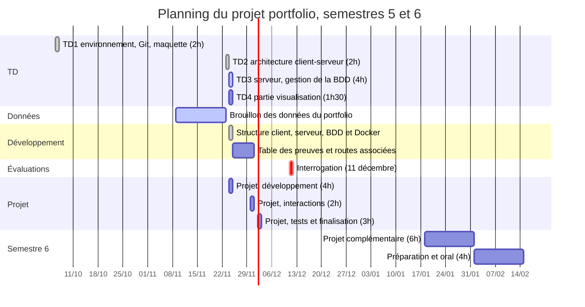

# Planning prévisionnel et suivi d'avancement

Ce document sert d'outil de pilotage. Il est mis à jour à chaque séance : les tâches terminées, en cours, à faire, les retards et les changements de planning y sont notés.

## Séances encadrées du semestre 5

| Séance | Date | Durée | Contenu prévu |
|---|---|---|---|
| TD1 | 6 octobre, semaine 41 | 2h | Environnement de travail, Git, planning et maquette |
| TD2 | 23 novembre, semaine 48 | 2h | Architecture client-serveur et communication HTTP |
| TD3 | 24 novembre, semaine 48 | 4h | Retour sur le serveur : gestion de la base de données |
| TD4 | 24 novembre, semaine 48 | 1h30 | Partie visualisation |
| Projet | 24 novembre, semaine 48 | 4h | Développement |
| Projet | 30 novembre, semaine 49 | 2h | Développement |
| Projet | 2 décembre, semaine 49 | 3h | Développement et finalisation du semestre |
| Interrogation | 11 décembre, semaine 50 | à confirmer | Évaluation écrite, à la fin du cours |

Au semestre 6 : 6h de projet, puis 4h de préparation et de présentation orale.

## Planning visuel

Légende : 🟩 terminé, 🟧 en cours, ⬜ à faire, 🟥 en retard.

Dans le diagramme, les barres grises sont terminées, les rouges sont les évaluations, les autres restent à faire. Les dates du semestre 6 sont indicatives.

### Suivi par séance

| Séance | Date | Durée | Avancement | État |
|---|---|---|---|---|
| TD1 | 6 octobre | 2h | 🟩🟩🟩🟩🟩 100 % | 🟩 Terminé |
| TD2 | 23 novembre | 2h | 🟩🟩🟩🟩🟩 100 % | 🟩 Terminé |
| TD3 | 24 novembre | 4h | 🟩⬜⬜⬜⬜ environ 20 % | 🟧 En cours |
| TD4 | 24 novembre | 1h30 | ⬜⬜⬜⬜⬜ 0 % | ⬜ À faire |
| Projet | 24 novembre | 4h | ⬜⬜⬜⬜⬜ 0 % | ⬜ À faire |
| Projet | 30 novembre | 2h | ⬜⬜⬜⬜⬜ 0 % | ⬜ À faire |
| Projet | 2 décembre | 3h | ⬜⬜⬜⬜⬜ 0 % | ⬜ À faire |
| Interrogation | 11 décembre | à confirmer | ⬜⬜⬜⬜⬜ 0 % | ⬜ À faire |
| Semestre 6, projet | à définir | 6h | ⬜⬜⬜⬜⬜ 0 % | ⬜ À faire |
| Semestre 6, oral | à définir | 4h | ⬜⬜⬜⬜⬜ 0 % | ⬜ À faire |

## Jalons

Début du projet, puis choix des données, maquette terminée, architecture définie, partie serveur fonctionnelle, première visualisation intégrée, interactions ajoutées, tests et corrections, version finale du semestre 5, puis finalisation et oral au semestre 6.

## Planning détaillé

| Tâche | Séance ou période prévue | Heures | État | Commentaire |
|---|---|---|---|---|
| Compréhension du sujet et choix du contenu du portfolio | TD1 | 0h30 | 🟩 Terminé | |
| Initialisation du dépôt Git et du README | TD1 | 0h30 | 🟩 Terminé | |
| Planning prévisionnel | TD1 | 0h30 | 🟩 Terminé | |
| Maquette du site | TD1 | 0h30 | 🟩 Terminé | Schémas et version visuelle en HTML, appelées à évoluer |
| Choix et préparation des données du portfolio | Entre TD1 et TD2 | à définir | 🟧 En cours | Brouillons dans `data/projets.csv` (9 novembre) et `data/competences.csv` (12 novembre), à relire et à compléter. Consigne du 24 novembre : les données finales doivent être dans PostgreSQL, interrogées par le serveur (pas de CSV) |
| Architecture générale du site et choix des technologies | TD2, puis TD3 | 2h | 🟩 Terminé | Choix faits le 24 novembre : Node.js avec Express pour le serveur, PostgreSQL lancé dans Docker, Chart.js pour les graphiques, dépôt organisé en `client/`, `serveur/` et `bdd/` |
| Base de données et contrôleur | TD3 | 4h | 🟧 En cours | Base personnelle et routes en place. Reste : relier chaque preuve au bon apprentissage critique et compléter les certificats sans date |
| Préparation à l'interrogation | Avant le 11 décembre | à définir | 🟧 En cours | Notes du cours sur l'architecture client-serveur, HTTP, les routes et l'injection SQL ; sujet de l'année précédente travaillé et corrigé |
| Partie visualisation : première visualisation | TD4 | 1h30 | ⬜ À faire | Dépend de la partie serveur |
| Développement des pages et intégration des visualisations | Projet du 24 novembre | 4h | ⬜ À faire | |
| Ajout des interactions : filtres et sélecteurs | Projet du 30 novembre | 2h | ⬜ À faire | |
| Tests, corrections et amélioration de l'interface | Projet du 2 décembre | 3h | ⬜ À faire | |
| Mise à jour de la documentation et bilan du semestre 5 | Projet du 2 décembre | incluse | ⬜ À faire | |
| Interrogation | 11 décembre | durée à confirmer | ⬜ À faire | Une seule interrogation, à la fin du cours |
| Développement complémentaire | Semestre 6 | 6h | ⬜ À faire | |
| Préparation et présentation orale | Semestre 6 | 4h | ⬜ À faire | |

## Dépendances principales

La maquette précède l'architecture. L'architecture précède la partie serveur. La partie serveur et les données précèdent la visualisation. Les visualisations précèdent les interactions. Les tests viennent à la fin du développement.

## Avancement par séance

### TD1, 6 octobre
- Création du dépôt et du README
- Rédaction du planning prévisionnel
- Réalisation de la maquette (schémas et pages HTML)

### Point du 9 novembre
- Ajout d'un premier brouillon des données du portfolio dans `data/` (liste de projets et description des colonnes)
- Ajout d'une section auteure dans le README
- Mise à jour du diagramme de Gantt : ajout de la tâche sur les données, et la tâche de développement du 24 novembre n'est plus marquée en cours puisqu'elle n'a pas commencé
- La séance TD2 du 23 octobre est passée : son état reste à confirmer dans ce document

### Point du 12 novembre
- Ajout d'un premier brouillon `data/competences.csv` : technologies comptées à partir des projets déjà listés, sans niveau de maîtrise (à définir)
- État du TD2 toujours à confirmer

### Point du 15 novembre
- Mise en cohérence du README avec le contenu de `data/` : `competences.csv` y est maintenant mentionné
- Aucune autre séance n'a eu lieu depuis le 12 novembre ; la prochaine séance encadrée est le TD3 du 23 novembre
- État du TD2 toujours à confirmer

### Point du 21 novembre
- Aucune séance encadrée n'est prévue entre le 23 octobre et le 23 novembre : la prochaine est le TD3 du 23 novembre (partie serveur), dans deux jours
- La tâche sur les données reste en cours dans le diagramme de Gantt (période prévue jusqu'au 23 novembre) : `data/projets.csv` et `data/competences.csv` sont toujours des brouillons à relire, avec des années à compléter
- État du TD2 toujours à confirmer

### Point du 23 novembre
- Le TD3 (partie serveur, base de données et contrôleur) est prévu aujourd'hui, de 4h : son déroulement et son avancement sont à confirmer, il reste donc marqué « À faire » dans le suivi et dans le diagramme de Gantt
- Les séances du 24 novembre (interrogation 1, TD4 et projet) suivent dès demain ; la préparation de l'interrogation 1 reste à faire
- La période prévue pour la tâche sur les données se termine aujourd'hui : `data/projets.csv` et `data/competences.csv` restent des brouillons à relire, avec des années à compléter
- État du TD2 toujours à confirmer

### TD2, 23 novembre
- Cours sur l'architecture client-serveur : rôle du client, du serveur et du SGBD, protocole HTTP, méthodes et CRUD, codes de statut, routes et paramètres, format JSON, injection SQL et validation des données
- Comparaison de Laragon et Docker
- TD sur papier « Architecture client-serveur et communication HTTP » (sujet de l'année précédente), corrigé en classe le 24 novembre

### TD3, 24 novembre
- Distribution du sujet « Retour sur le serveur : gestion de la BDD » (exercices 1 à 6 : schéma relationnel avec les preuves, routes, environnement, images et table des preuves, finitions)
- Consignes du projet précisées par l'enseignante : le dépôt contient au minimum le client, le serveur et le fichier SQL ; les données sont interrogées dans une base SQL par un serveur ; `node_modules` n'est pas versionné ; un formulaire d'ajout de données est un bonus
- Choix techniques : Node.js avec Express et PostgreSQL lancé dans Docker
- Mise en place de la structure du dépôt (`client/`, `serveur/`, `bdd/`, `docker-compose.yml`) à partir du programme de visualisation fourni ; la chaîne complète navigateur, serveur et base fonctionne en local
- Configuration d'un Codespace GitHub pour tester le site en ligne
- Schéma relationnel personnel : le référentiel du BUT SD est complété par mes formations, expériences, projets, technologies, certificats, langues et preuves
- Base enrichie (`bdd/init_db.sql`), 11 nouvelles routes dans le serveur, et 5 pages reliées à l'API (Accueil, Parcours, Projets, Compétences, Contact)
- Refonte de la base sur le programme national du BUT SD : schéma `referentiel` (compétences, composantes essentielles, niveaux, 54 AC, 30 SAÉ, stages et portfolios) et schéma `portfolio` ; une preuve peut démontrer plusieurs AC et se rattache à une SAÉ au plus ; règles de cohérence vérifiées par la base

### À faire ensuite
- TD3, exercice 1 : schéma relationnel reliant toutes les tables, avec une table des preuves (image et/ou texte), à faire valider par l'enseignante
- TD3, exercices 4 et 5 : intégrer la table des preuves dans `bdd/init_db.sql`, ajouter les routes d'accès à une preuve et à toutes les preuves, les afficher dans le site
- Remplacer les images de test par les preuves du portfolio
- Relire et compléter `data/projets.csv`, puis transférer les données dans la base

## Retards, difficultés et changements de planning

- 24 novembre : les technologies du site sont choisies (Node.js, Express, PostgreSQL dans Docker, Chart.js). L'option Flask fournie en exemple n'est pas retenue.
- Évaluations : il n'y a qu'une seule interrogation, le 11 décembre, à la fin du cours. Les interrogations prévues le 24 novembre et le 2 décembre dans la première version du planning n'ont pas lieu.
- Le TD2, prévu le 23 octobre, a eu lieu le 23 novembre ; le TD3 a suivi le 24 novembre.
