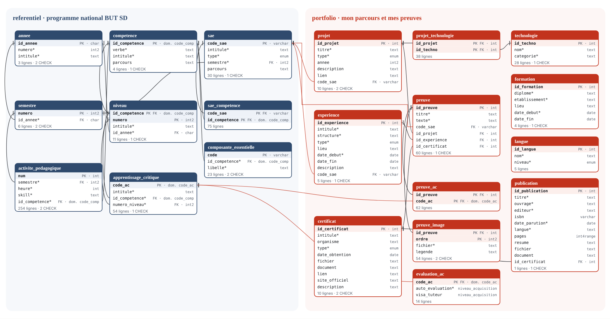

# Portfolio de visualisation de données

Projet réalisé à l'issue du module Programmation Web pour la visualisation (BUT Sciences des Données, parcours VCOD, IUT de Besançon-Vesoul, antenne de Dôle).

## Auteure

Francisca Wetimane, étudiante en 3e année de BUT Sciences des Données, parcours VCOD (Visualisation, Conception d'Outils Décisionnels), en alternance. Je travaille en français, en portugais et en anglais.

## Sujet et objectif

Ce projet est un site web qui met en valeur mes compétences en science des données et en visualisation, pour de futurs employeurs ou de futures formations. Il présente mon parcours, mes projets et mes compétences, et utilise des visualisations de données interactives pour rendre ces informations explorables plutôt que simplement lisibles.

## Données utilisées et origine

Les données affichées proviennent de mon propre parcours : liste de projets réalisés, technologies utilisées, niveaux de compétence, dates et durées des expériences. Elles seront croisées avec le référentiel national du BUT Science des Données (compétences, niveaux, composantes essentielles et apprentissages critiques du parcours VCOD, 2e et 3e années), afin de relier chaque projet du portfolio aux apprentissages critiques qu'il démontre. Elles seront stockées dans une base de données PostgreSQL, que le site interrogera pour alimenter les pages et les visualisations. Le schéma relationnel de la base est présenté dans la partie « Base de données » ci-dessous.

Un premier brouillon de la liste des projets est disponible dans `data/projets.csv`, et un brouillon des technologies utilisées dans `data/competences.csv` (sans niveau de maîtrise pour l'instant). Les colonnes de ces deux fichiers sont décrites dans `data/README.md`. Les projets réalisés pour une entreprise ou sous accord de confidentialité n'y figurent pas sans accord écrit.

## Principales fonctionnalités prévues

- Page d'accueil de présentation avec accès rapide aux autres sections
- Frise chronologique du parcours (formation, stage, projets)
- Galerie de projets avec filtres par technologie et par type de projet
- Visualisation des compétences avec choix du critère d'affichage
- Page de contact

## Technologies et bibliothèques

À confirmer au fil des séances (architecture et partie serveur au TD2 et TD3). Pour l'instant :

- HTML et CSS pour la structure et la mise en page
- JavaScript pour les interactions
- PostgreSQL pour la base de données
- Node.js avec Express pour le serveur (routes de l'API)
- Chart.js pour les graphiques
- Docker pour lancer la base PostgreSQL dans un conteneur
- Git et GitHub pour le suivi du projet

## Exécution du projet

Prérequis : Docker Desktop et Node.js (version 20.6 ou plus récente).

1. Créer un fichier `.env` à la racine du dépôt, contenant une seule ligne : `POSTGRES_PASSWORD=` suivi du mot de passe choisi. Ce fichier est ignoré par Git (voir `.gitignore`) et n'est donc jamais envoyé sur GitHub.
2. Lancer la base de données, depuis la racine du dépôt :
   ```
   docker compose up -d
   ```
3. Installer les dépendances puis lancer le serveur :
   ```
   cd serveur
   npm install
   npm start
   ```
4. Ouvrir `http://localhost:3000` dans le navigateur.

### Dans un Codespace GitHub (sans rien installer)

1. Sur la page du dépôt : bouton **Code**, onglet **Codespaces**, **Create codespace on main**.
2. Attendre la fin de la préparation : le fichier `.env` (mot de passe aléatoire), les dépendances et la base PostgreSQL sont mis en place automatiquement par les scripts du dossier `.devcontainer/`.
3. Dans le terminal du Codespace :
   ```
   cd serveur
   npm start
   ```
4. Ouvrir l'onglet **Ports**, puis le port 3000 (« Site du portfolio ») : le site s'affiche dans le navigateur.

Pour arrêter la base : `docker compose down` (les données sont conservées dans un volume Docker).

À chaque démarrage, le serveur recrée les tables à partir de `bdd/init_db.sql` : les données à garder doivent donc être écrites dans ce fichier.

## Base de données



- Une preuve démontre un ou plusieurs apprentissages critiques (table `preuve_ac`), se rattache à une SAÉ au plus, et vient d'un projet, d'une expérience ou d'un certificat.
- Une SAÉ cible une ou plusieurs compétences (table `sae_competence`), comme dans le programme national.
- Un déclencheur refuse qu'une preuve démontre un AC qui n'appartient à aucune compétence de sa SAÉ.
- Une preuve a un texte et zéro, une ou plusieurs captures d'écran ordonnées (table `preuve_image`).
- Chaque AC peut avoir mon auto-évaluation et le visa du tuteur (table `evaluation_ac`), repris dans la vue `couverture_ac`.
- Types fermés (ENUM), domaines pour les codes de compétence et d'AC, contraintes CHECK et index sur les clés étrangères.

## Routes de l'API

| Route | Données renvoyées |
|---|---|
| `GET /api/heures` | heures du BUT par compétence |
| `GET /api/heures-par-annee` | heures par année et par compétence |
| `GET /api/competences`, `GET /api/competence/:id` | compétences du BUT |
| `GET /api/competence/:id/preuves` | preuves d'une compétence, avec leur source et leurs captures |
| `GET /api/projets?type=…&techno=…` | projets, filtrables par type et par technologie |
| `GET /api/projet/:id` | un projet, ses technologies et ses preuves |
| `GET /api/technologies` | technologies et nombre de projets |
| `GET /api/formations`, `GET /api/experiences` | parcours |
| `GET /api/certificats`, `GET /api/langues` | certificats, distinctions et langues |
| `GET /api/publications` | publications et distinction liée |
| `GET /api/preuves`, `GET /api/preuve/:id` | preuves |
| `GET /api/couverture` | nombre de preuves par apprentissage critique |
| `GET /api/sae` | SAÉ du programme national et compétences ciblées |

Les images (`/preuves/<fichier>`) et les pages sont servies par la route statique du dossier `client/`.

## Organisation du dépôt

- `client/` : le site vu dans le navigateur : 5 pages (`index.html`, `parcours.html`, `projets.html`, `competences.html`, `contact.html`), un script par page, `commun.js` et `style.css` partagés, images des certificats et preuves dans `preuves/`
- `serveur/` : le serveur Express (`server.js`) et la liste de ses dépendances (`package.json`)
- `bdd/` : le script SQL qui crée et remplit la base (`init_db.sql`) et son diagramme (`schema-relationnel.png`). Deux schémas PostgreSQL : `referentiel` (programme national du BUT SD, parcours VCOD : compétences, composantes essentielles, niveaux, apprentissages critiques, SAÉ) et `portfolio` (formations, expériences, projets, technologies, certificats, publications, langues, preuves)
- `docker-compose.yml` : la base PostgreSQL lancée dans un conteneur Docker
- `.devcontainer/` : configuration du Codespace GitHub (Node.js, Docker et lancement automatique de la base)
- `.gitignore` : fichiers exclus de Git (`node_modules/` et `.env`, qui contient le mot de passe de la base)
- `README.md` : présentation du projet
- `AVANCEMENT.md` : planning prévisionnel et suivi de l'avancement
- `maquette/` : maquette du site (captures des pages dans `images/`) et schéma relationnel à jour
- `data/` : données du portfolio (brouillon : `projets.csv`, `competences.csv`) et description des colonnes

## Difficultés et limites connues

Aucune à ce stade. Cette section sera mise à jour au fur et à mesure du projet.
