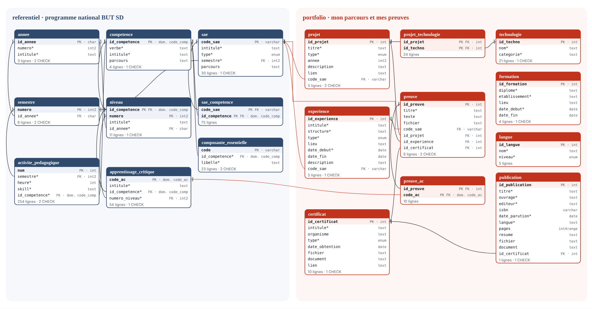
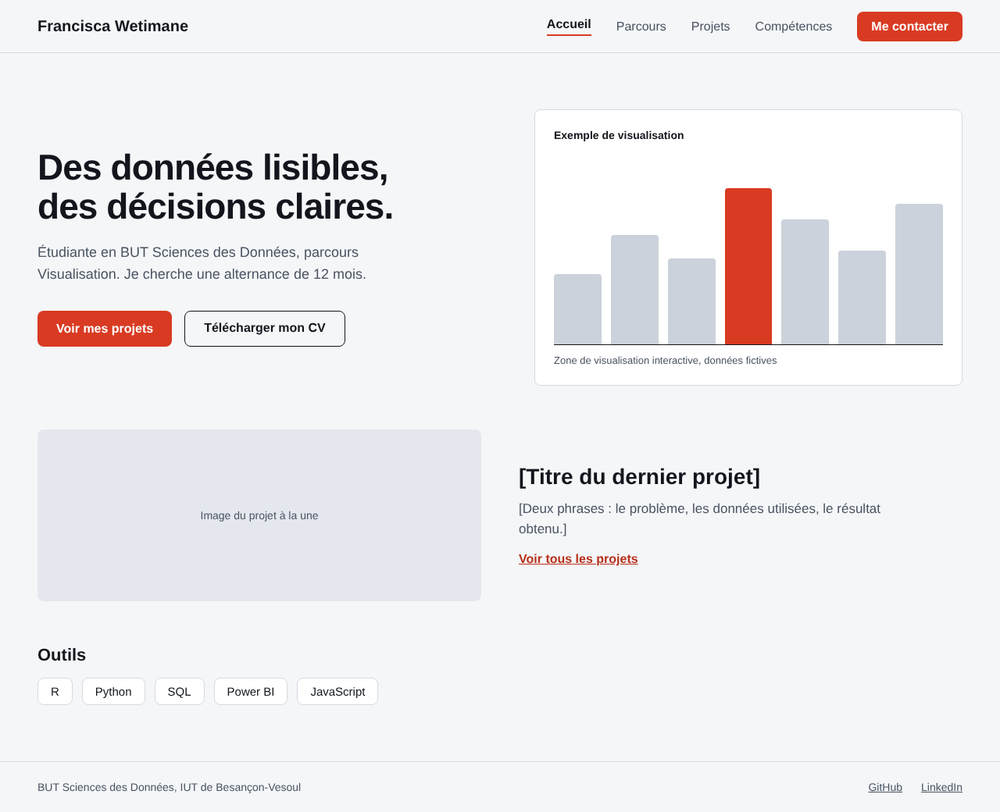
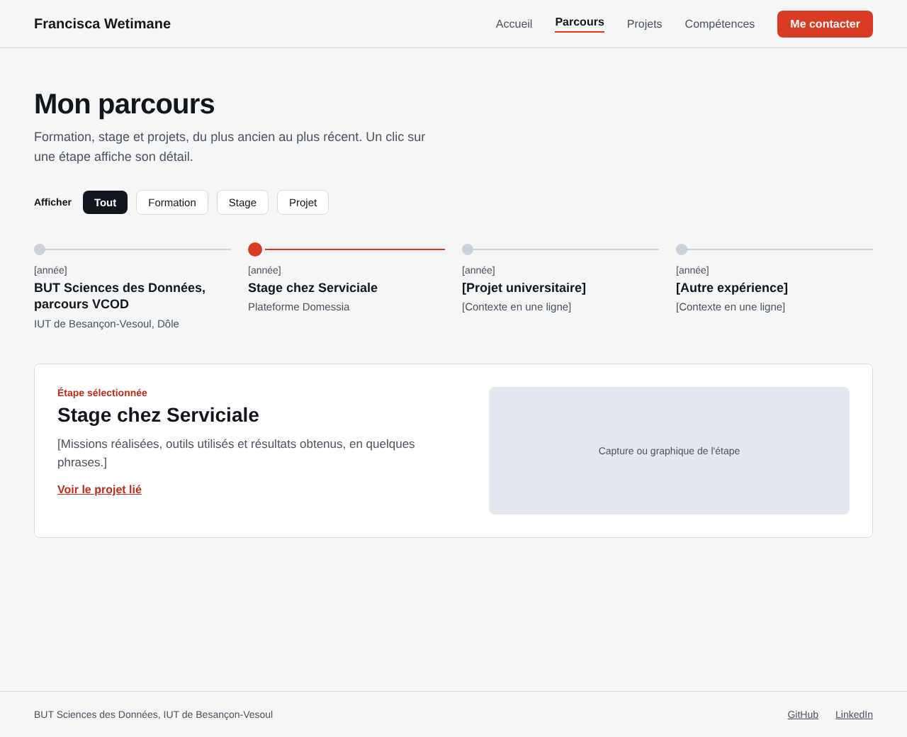
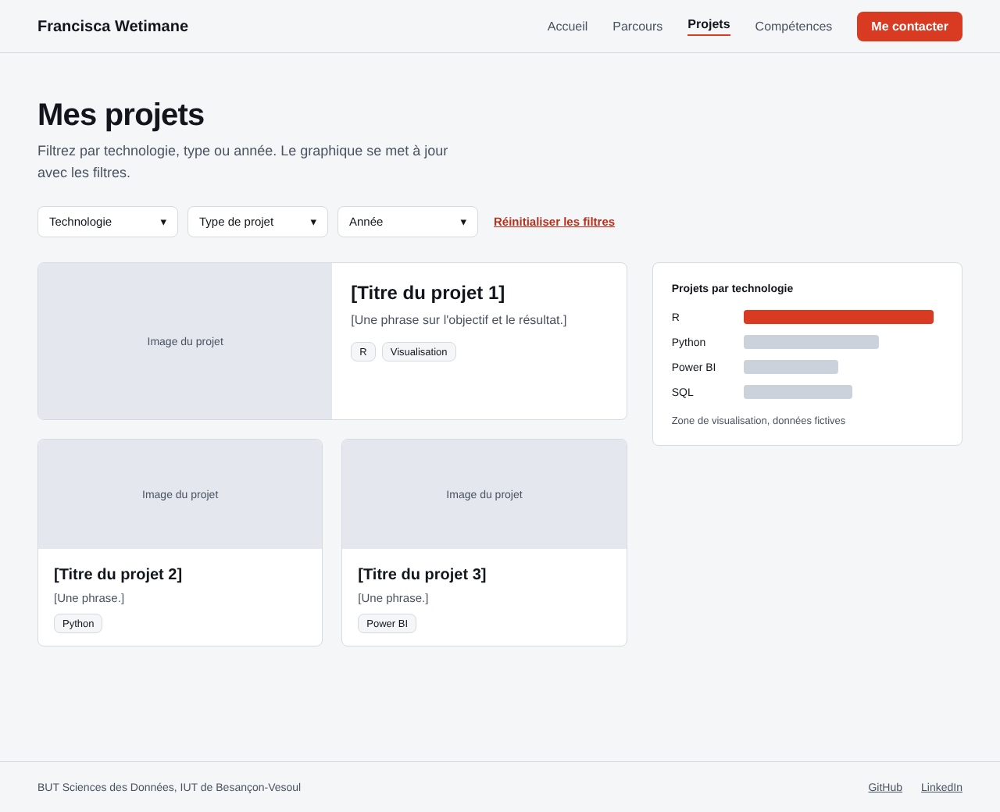
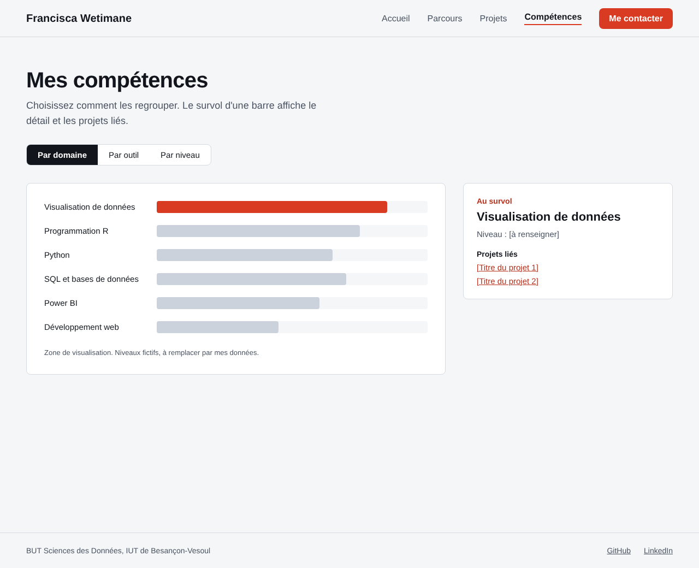
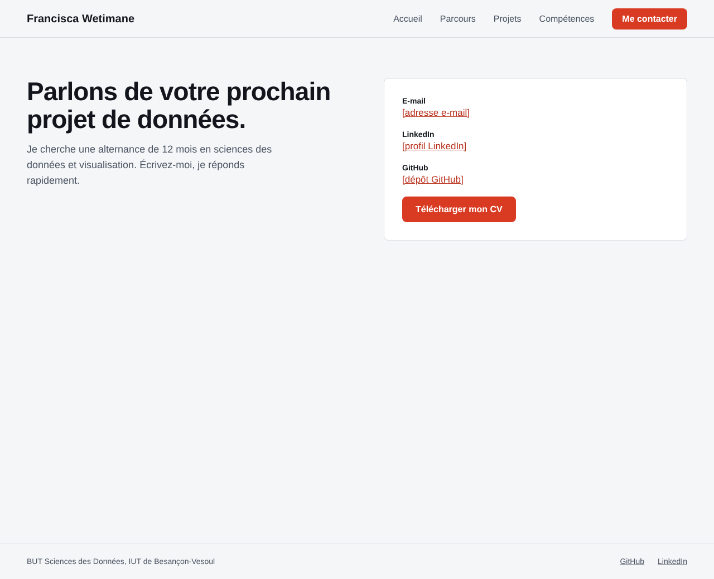
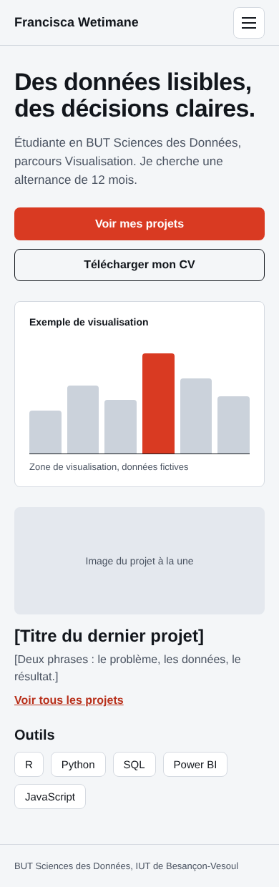

# Maquette du site portfolio

Cette maquette décrit l'organisation du site avant le développement. Les schémas de ce document montrent les pages, la navigation, la place des visualisations et des éléments interactifs, sans fixer les couleurs ni les polices.

## Version visuelle

La version visuelle des pages est conservée sous forme d'images dans le dossier `images/` : Accueil, Parcours, Projets, Compétences, Contact et Accueil sur mobile. Elle fixe la direction graphique reprise par le site : fond gris très clair, texte presque noir, un seul accent rouge-orangé pour les boutons et les éléments sélectionnés, titres en Bricolage Grotesque et texte en Figtree. Les passages entre crochets et les données fictives de ces images ont été remplacés, dans le site, par les données de la base.

## Schéma de la base de données

Le schéma relationnel ci-dessous est généré depuis le catalogue PostgreSQL. Il remplace le premier schéma d'octobre : le schéma `referentiel` reprend le programme national du BUT Science des données (parcours VCOD), le schéma `portfolio` contient mon parcours, mes publications et mes preuves.



## Aperçus de la version visuelle

### Accueil


### Parcours


### Projets


### Compétences


### Contact


### Accueil sur mobile


## Pages et navigation

Le menu est présent en haut de toutes les pages et contient les liens suivants : Accueil, Parcours, Projets, Compétences, Contact.

```
Accueil ---> Parcours
   |  \
   |   +---> Projets ---> Détail d'un projet
   |
   +-------> Compétences
   |
   +-------> Contact
```

## Structure commune

```
+------------------------------------------------------------+
| LOGO / NOM      Accueil  Parcours  Projets  Compétences  Contact |
+------------------------------------------------------------+
|                                                            |
|                   CONTENU DE LA PAGE                       |
|                                                            |
+------------------------------------------------------------+
| PIED DE PAGE : liens GitHub et LinkedIn, mentions          |
+------------------------------------------------------------+
```

## Page Accueil

```
+------------------------------------------------------------+
| MENU                                                       |
+------------------------------------------------------------+
|                                                            |
|   Nom et titre : étudiante en sciences des données         |
|   Courte phrase de présentation                            |
|                                                            |
|   [Voir mes projets]   [Voir mes compétences]              |
|                                                            |
+------------------------------------------------------------+
|  Chiffres clés : nombre de projets | technologies | années |
+------------------------------------------------------------+
```

Éléments interactifs : deux boutons d'accès rapide. Les chiffres clés sont calculés à partir des données.

## Page Parcours

```
+------------------------------------------------------------+
| MENU                                                       |
+------------------------------------------------------------+
| TITRE : Mon parcours                                       |
|                                                            |
|  FRISE CHRONOLOGIQUE                                       |
|  |----o--------o-----------o----------o---->  temps        |
|    Étape 1   Étape 2    Étape 3    Étape 4                 |
|                                                            |
|  +------------------------------------------------------+  |
|  | Détail de l'étape sélectionnée                       |  |
|  +------------------------------------------------------+  |
|                                                            |
|  Filtre : [Formation] [Stage] [Projet]                     |
+------------------------------------------------------------+
```

Éléments interactifs : clic sur une étape pour afficher son détail, filtre par type d'étape.

## Page Projets

```
+------------------------------------------------------------+
| MENU                                                       |
+------------------------------------------------------------+
| TITRE : Mes projets                                        |
| Filtres : [Technologie v] [Type v] [Année v] [Réinitialiser]|
|                                                            |
|  +------------+  +------------+  +------------+            |
|  | Projet 1   |  | Projet 2   |  | Projet 3   |            |
|  | miniature  |  | miniature  |  | miniature  |            |
|  | étiquettes |  | étiquettes |  | étiquettes |            |
|  +------------+  +------------+  +------------+            |
|                                                            |
|  +------------------------------------------------------+  |
|  | VISUALISATION : répartition des projets              |  |
|  | par technologie (réagit aux filtres)                 |  |
|  +------------------------------------------------------+  |
+------------------------------------------------------------+
```

Éléments interactifs : menus de filtre, bouton de réinitialisation, clic sur une carte pour ouvrir le détail du projet. La visualisation se met à jour selon les filtres.

## Page Compétences

```
+------------------------------------------------------------+
| MENU                                                       |
+------------------------------------------------------------+
| TITRE : Mes compétences                                    |
|                                                            |
| Affichage : (o) par domaine   ( ) par outil   ( ) par niveau|
|                                                            |
|  +------------------------------------------------------+  |
|  |                                                      |  |
|  |              VISUALISATION DES COMPÉTENCES           |  |
|  |                                                      |  |
|  +------------------------------------------------------+  |
|                                                            |
|  Information affichée au survol : nom, niveau, projets liés|
+------------------------------------------------------------+
```

Éléments interactifs : sélecteur du mode d'affichage, infobulle au survol de chaque élément.

## Page Contact

```
+------------------------------------------------------------+
| MENU                                                       |
+------------------------------------------------------------+
| TITRE : Me contacter                                       |
|                                                            |
|  Coordonnées et liens (LinkedIn, GitHub)                   |
|                                                            |
|  [Télécharger mon CV]                                      |
+------------------------------------------------------------+
```

## Adaptation aux petits écrans

Sur mobile, le menu devient un bouton déroulant. Les cartes de projets passent sur une seule colonne et les filtres s'empilent verticalement.

## Évolution de la maquette

| Date | Modification | Raison |
|---|---|---|
| 6 octobre | Première version | Création initiale lors du TD1 |
| 6 octobre | Ajout de la version visuelle des pages en HTML | Fixer l'organisation et la direction graphique avant le développement |
| 6 octobre | Ajout des captures d'écran des pages | Consulter la maquette directement dans la documentation |
